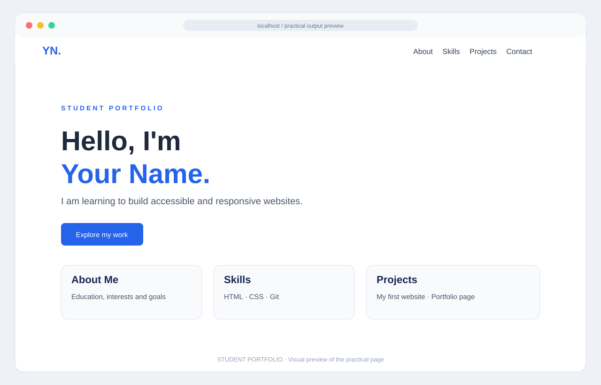

# Output – Semantic Portfolio

This preview shows the portfolio structure with navigation, hero, About, Skills, Projects and Contact sections.

> This is a visual output preview based on the current HTML/CSS example. Open `index.html` in a browser to see the live page and verify the result at different screen sizes.
