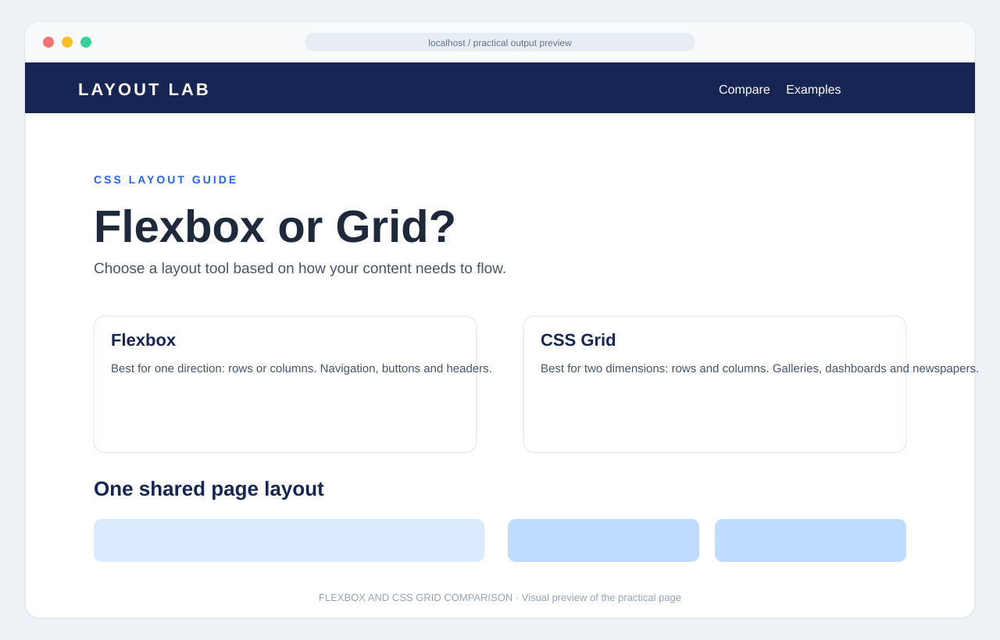

# Output – Flexbox vs Grid

This preview compares one-dimensional Flexbox alignment with a two-dimensional CSS Grid content area.

> This is a visual output preview based on the current HTML/CSS example. Open `index.html` in a browser to see the live page and verify the result at different screen sizes.
